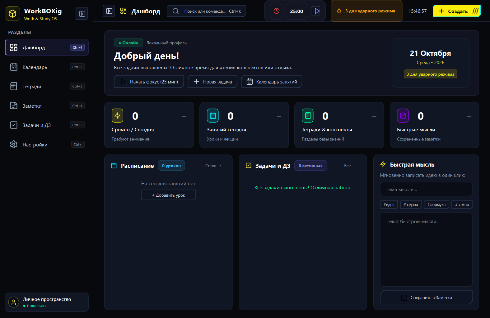
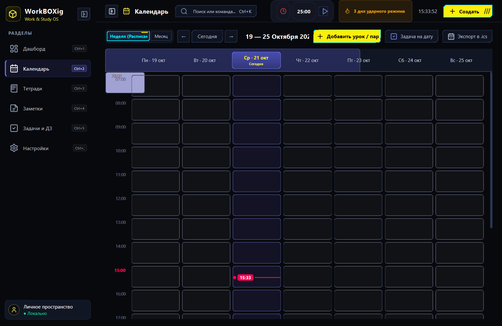
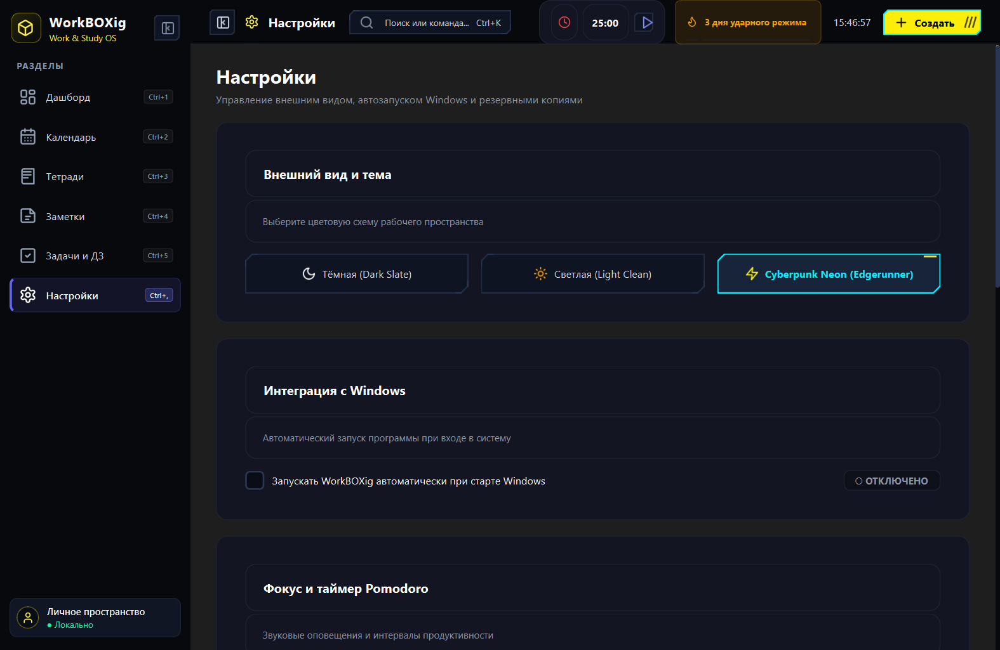
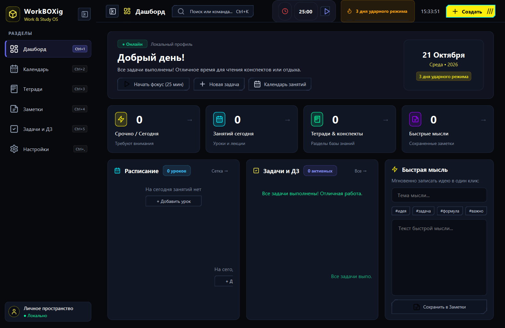
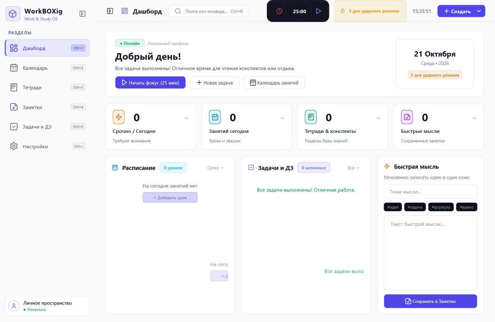

<div align="center">

# 📦 WorkBOXig

### *Executive Work & Study OS for Windows*

<p>
  <a href="README.md">🇬🇧 <b>English</b></a> • 🇷🇺 <b>Русский</b>
</p>

[](https://python.org)
[](https://www.riverbankcomputing.com/software/pyqt/)
[](https://microsoft.com)
[](LICENSE)
[]()

**WorkBOXig** — это современная, быстрая и эстетичная рабочая среда для учёбы, проектов и повседневной продуктивности. Программа объединяет недельное расписание, тетради с конспектами, трекер задач, таймер Pomodoro, нативные уведомления Windows, двуязычный интерфейс (RU / EN) и Spotlight Command Palette (`Ctrl+K`).

---



</div>

---

## ✨ Основные возможности

### 📊 Дашборд продуктивности
- **Метрики дня**: количество горящих дедлайнов, расписание на сегодня, статус заметок и счётчик ударного режима (streak).
- **Быстрая мысль**: мгновенная фиксация идеи или формулы в один клик прямо с главного экрана.
- **Интерактивные виджеты**: быстрый запуск сессии фокуса и добавление задач.

### 📅 Интерактивный недельный календарь
- **Поминутная полоса текущего времени**: неоновый индикатор времени с маркером и автопрокруткой к текущему часу.
- **Экспорт в iCalendar (`.ics`)**: полная совместимость с Google Календарём, Apple Calendar и Яндекс Календарём (RFC 5545).
- **Два режима отображения**: недельная таймлайн-сетка уроков/пар и классический обзор месяца.

### 📓 Тетради и конспекты
- Иерархическая структура: модули/предметы и страницы.
- **Rich-text редактор**: заголовки, списки, выделение цветом, цитаты, выравнивание.
- **Вставка изображений и диаграмм**: поддержка скриншотов и иллюстраций без потерь форматирования.

### ✅ Задачи и домашние задания
- Фильтрация по статусу, предмету и срочности (*Срочно*, *Высокий*, *Обычный*).
- Автоматический подсчёт оставшегося времени до дедлайна.
- Быстрый ввод задач прямо из интерфейса или через Command Palette.

### ⏱ Таймер фокуса Pomodoro
- Встроенный в верхнюю панель таймер фокуса (25 минут работы / 5 минут отдыха).
- **Полноэкранный Zen Mode** (`Ctrl+T`): максимальная концентрация без отвлекающих факторов.
- Звуковые оповещения об окончании интервалов.

### 🎨 3 темы оформления с переключением на лету
1. **Dark (Executive Slate)**: строгая премиальная тёмная палитра в духе Linear и Raycast.
2. **Light (Clean Studio)**: мягкая светлая тема с высокой контрастностью и комфортом для глаз.
3. **Cyberpunk Neon (Edgerunner Style)**:
   - **Настоящая аниме-рисовка кнопок**: скошенные углы под 45° (chamfered corners), предупреждающая штриховка (`///`), неоновые рамки Cyan (`#00F0FF`) и акценты Sandevistan Yellow (`#FCEE0A`).
   - 100% юридическая чистота без использования защищенных товарных знаков и чужих логотипов.

### 🌐 Двуязычный интерфейс (RU / EN)
- Мгновенное переключение языка прямо в настройках без перезагрузки программы.
- Полная локализация на русский и чистый английский язык.

### 🔔 Нативные уведомления Windows
- Всплывающие карточки в правом нижнем углу экрана с поддержкой анимации и звука.
- Автоматические напоминания о парах за 15 минут до начала.
- Предупреждения о дедлайнах горящих задач на сегодня.

### ⚡ Universal Spotlight (`Ctrl+K`)
- Мгновенный глобальный поиск по всем задачам, тетрадям, конспектам и заметкам.
- Быстрое переключение тем, запуск фокуса и навигация по разделам.

---

## 📸 Галерея скриншотов

| Недельный календарь (Cyberpunk) | Настройки и выбор тем |
| :---: | :---: |
|  |  |

| Тёмная классическая тема (Slate) | Светлая тема (Light Clean) |
| :---: | :---: |
|  |  |

---

## 🚀 Быстрый старт

### Требования
- **ОС**: Windows 10 или Windows 11 (64-bit)
- **Python**: 3.10 или новее (при запуске из исходного кода)

### 1. Установка из готового установщика
Скачайте готовый автономный файл установки из [Releases](https://github.com/FN1p/WorkBOXig/releases) или соберите его самостоятельно:
- `dist/WorkBOXig_Setup.exe` — графический установщик с выбором пути, созданием ярлыков и опцией автозапуска.
- `dist/WorkBOXig.exe` — портативный исполняемый файл (не требует установки).

### 2. Запуск из исходного кода
```bash
# Клонируйте репозиторий
git clone https://github.com/FN1p/WorkBOXig.git
cd WorkBOXig

# Создайте и активируйте виртуальное окружение
python -m venv venv
venv\Scripts\activate

# Установите зависимости
pip install -r requirements.txt

# Запустите приложение
python main.py
```

---

## 🛠️ Сборка собственного `.exe`

Для сборки автономного бинарника и инсталлятора используется PyInstaller:

```bash
# 1. Сборка основного исполняемого файла WorkBOXig.exe
pyinstaller WorkBOXig.spec --noconfirm

# 2. Сборка графического установщика WorkBOXig_Setup.exe
pyinstaller installer.spec --noconfirm
```

Готовые файлы появятся в директории `dist/`.

---

## ⌨️ Горячие клавиши

| Сочетание клавиш | Действие |
| :--- | :--- |
| <kbd>Ctrl</kbd> + <kbd>K</kbd> | Открыть командную строку Spotlight (быстрый поиск) |
| <kbd>Ctrl</kbd> + <kbd>T</kbd> | Открыть Zen-режим таймера Pomodoro |
| <kbd>Ctrl</kbd> + <kbd>B</kbd> | Свернуть / развернуть боковое меню (компактный режим) |
| <kbd>Ctrl</kbd> + <kbd>1</kbd> | Перейти в **Дашборд** |
| <kbd>Ctrl</kbd> + <kbd>2</kbd> | Перейти в **Календарь и расписание** |
| <kbd>Ctrl</kbd> + <kbd>3</kbd> | Перейти в **Тетради и конспекты** |
| <kbd>Ctrl</kbd> + <kbd>4</kbd> | Перейти в **Заметки** |
| <kbd>Ctrl</kbd> + <kbd>5</kbd> | Перейти в **Задачи и ДЗ** |
| <kbd>Ctrl</kbd> + <kbd>,</kbd> | Открыть **Настройки** |
| <kbd>Ctrl</kbd> + <kbd>N</kbd> | Создать новую быструю заметку |
| <kbd>Ctrl</kbd> + <kbd>S</kbd> | Принудительно сохранить все данные на диск |

---

## 📁 Структура проекта

```
WorkBOXig/
├── assets/                 # Векторные и растровые иконки, скриншоты
├── src/
│   ├── components/         # Переиспользуемые UI-компоненты
│   │   ├── command_palette.py      # Spotlight поиск (Ctrl+K)
│   │   ├── desktop_notification.py # Всплывающие алерты Windows
│   │   ├── pomodoro.py             # Pomodoro таймер и Zen Mode
│   │   ├── rich_editor.py          # Редактор конспектов с поддержкой картинок
│   │   ├── sidebar.py              # Боковая навигация с анимацией
│   │   └── toast.py                # Внутриоконные тосты
│   ├── views/              # Экраны приложения
│   │   ├── calendar_view.py        # Недельная сетка и iCalendar (.ics) экспорт
│   │   ├── dashboard_view.py       # Главный обзор дня и метрики
│   │   ├── notebooks_view.py       # Тетради и страницы
│   │   ├── notes_view.py           # Быстрые заметки
│   │   ├── settings_view.py        # Настройки тем, автозапуска и бэкапов
│   │   └── tasks_view.py           # Менеджер домашних заданий
│   ├── utils/              # Системные утилиты
│   │   ├── autostart.py            # Управление автозапуском Windows (winreg)
│   │   └── shortcuts.py            # Очистка лейаутов и горячие клавиши
│   ├── icons.py            # Движок векторных SVG-иконок
│   ├── i18n.py             # Движок интернационализации (RU / EN)
│   ├── main_window.py      # Главное окно координатор
│   ├── storage.py          # Локальное хранилище данных (атомарный JSON)
│   ├── styles.py           # Дизайн-системы Dark и Light
│   └── styles_cyber.py     # Аниме-движок отрисовки кнопок Edgerunners
├── tests/                  # Набор unit-тестов (25 тестов)
├── installer.py            # Исходный код собственного инсталлятора
├── WorkBOXig.spec          # Спецификация сборки приложения
├── installer.spec          # Спецификация сборки инсталлятора
├── requirements.txt        # Список зависимостей Python
└── README.md
```

---

## 🧪 Запуск тестов

Проект покрыт автоматическими тестами:

```bash
python -m unittest tests/test_app.py
```

---

## 📄 Лицензия

Проект распространяется под открытой лицензией [MIT](LICENSE).
Каждый может свободно использовать, модифицировать и собирать проект для любых целей.
